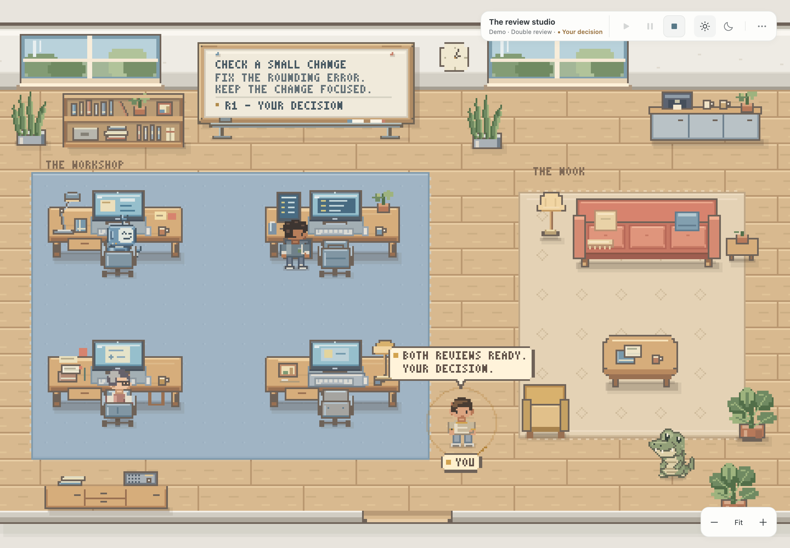

# ZipperCrew

Give a task to a small team of AI agents and follow their work in a pixel office.
The Worker changes files in your local repository. Reviewers check the result.
You decide whether to keep it or ask for another round.

The room is the interface. Click an agent to configure it, the whiteboard to
write your task, and your own character when a decision needs your attention.
[ZipperGen](https://github.com/zippergen-io/zippergen) runs the workflow behind
these interactions.



*Double review in the pixel office. This screenshot uses the scripted demo and sample task data.*

ZipperCrew is an early local app for private testing. You need a terminal for
installation. After that, you work in the browser.

[Install](#install) · [First task](#your-first-task) · [Workflows](#workflows) · [Troubleshooting](#troubleshooting)

## Install

### What you need

- macOS or Linux. Native Windows is not supported yet.
- Git, Python 3.11 or newer, and [uv](https://docs.astral.sh/uv/getting-started/installation/).
- GitHub access to both the ZipperCrew and ZipperGen repositories.
- For real tasks, a working installation of Codex CLI or Claude Code, signed in
  with an account that can use your chosen model. You can use either CLI or both.
  The demo does not need either one.

### Get the app

Keep the two repositories next to each other. ZipperCrew currently loads the
ZipperGen source checkout, so installing ZipperGen from PyPI alone is not enough.

```sh
mkdir -p ~/zippergen-io
cd ~/zippergen-io
git clone https://github.com/zippergen-io/zippergen.git
git clone https://github.com/zippergen-io/zippercrew.git
cd zippercrew
uv sync --locked
```

If you already have these checkouts, use them instead of cloning again.
There is no frontend build or npm install for ZipperCrew.

### Set up a coding agent

Follow the official setup guide for the CLI you want to use:

- [Codex CLI](https://learn.chatgpt.com/docs/codex/cli): install it, run `codex`, and sign in.
- [Claude Code](https://code.claude.com/docs/en/quickstart): install it, run `claude`, and sign in.

Finish any first-run prompts in the terminal before starting a task in ZipperCrew.
The app uses the CLI's own saved login. It has no API-key field and does not pass
`OPENAI_API_KEY` or `ANTHROPIC_API_KEY` from the server environment to agents.

### Start ZipperCrew

From the `zippercrew` directory:

```sh
uv run zippercrew
```

Open **[http://127.0.0.1:8765/office/](http://127.0.0.1:8765/office/)** and keep the
terminal running. Use the `/office/` address for the current pixel interface.

Closing the browser does not stop a run. Pressing Ctrl-C in the server terminal
does stop it. Start the app from the same directory next time to reopen your rooms.

### Try the interface without model usage

Use the demo if you want to explore before configuring a coding agent:

```sh
uv run zippercrew --demo --port 8766 --data-dir .zippercrew/demo
```

Open **[http://127.0.0.1:8766/office/](http://127.0.0.1:8766/office/)**. The separate
port and data directory keep demo rooms apart from your real rooms.

The demo runs the actual workflow with scripted agent responses. It makes no
model calls and does not edit repository files. You still choose a local folder
when setting up a room. Demo responses are illustrative and do not solve your task.

## Your first task

Start with a small, concrete change in a repository you can inspect afterward.
Use a clean branch or a separate checkout, since the Worker edits files directly.

1. Open the **⋯ menu → Rooms → + New room**. Give the room a name and choose
   **Review** for a first run. The required agents appear automatically.
2. Click the **room name** in the top bar. Use **Browse** to select the repository
   you want the Worker to change. This is your working project, not the ZipperCrew
   installation directory. Room options save as you edit them.
3. Click each **AI agent**. Choose an avatar and model. Leave reasoning effort
   at its default if unsure. Extra instructions are optional. Click **Save agent**.
   You can use the same model for both roles. Their conversations remain separate.
   In demo mode, the scripted model is already selected.
4. Click the **whiteboard** and write the task. The first line becomes its title.
   The rest should describe the result you want and how to check it. Task edits
   save as you type. If a save fails, the board and header show **Task not saved**.
   Open either to retry. Play stays disabled until the save succeeds.
5. Click **Run task**, or close the panel and press **Play** in the top bar.
   Play becomes available once the repository, task, and required models are set.
6. When **Your decision** appears, click **You** or the room header. Read the
   recommendation and reason, then choose the next action. All available decisions
   appear together. Detailed findings expand inside the same panel.

For example, in a small project with a README:

```text
Improve the installation guide
Check the README instructions against the project files.
Fix missing steps and incorrect commands in the README only.
Do not change application code or add dependencies.
Explain what you checked and anything you could not verify.
```

**Ship it** finishes the run. Direct uses **Done** for the same purpose.
Neither button commits, pushes, merges, or deploys your changes. Inspect the
result in your usual editor and Git tools.

**Run next round** sends the review feedback back to the Worker automatically.
Use **Add a note for the Worker** if you want to add guidance. The note is optional.
The note also reaches every reviewer as an amendment to the task on subsequent
rounds, so requested additions are reviewed against your updated instructions.
**Abandon** ends the run and leaves existing file changes in place.

### Model defaults

**Codex built-in default** uses the CLI's built-in model and effort. ZipperGen
isolates Codex from user configuration, so this does not use the model or effort
in `~/.codex/config.toml`. **Claude configured default** uses Claude's settings.
Choosing an explicit model and effort pins them for every call, including resumed
sessions and review-format repairs.

Named models show the effort levels advertised by local CLI metadata. Claude's default
choice shows the CLI's advertised levels, which can vary by model. For Codex's
built-in default, choose a named model to set effort. Previously saved overrides
remain visible and can be reset to Default. Known mismatches in externally
configured profiles are rejected before a run starts. Missing or outdated metadata
cannot prove what a provider supports, and an accepted CLI argument alone does not
prove the provider applied that effort.

## Finding your way around

| Click | What you can do |
| --- | --- |
| Whiteboard | Read, edit, and run the task |
| AI agent | Choose an avatar, model, and reasoning effort, add instructions, or inspect activity |
| You, when highlighted | Make the pending decision |
| Room name | Choose the workflow, repository, and room options, or open a pending decision |
| ⋯ menu | Switch rooms or open History |

Move your character with WASD or the arrow keys. Press Enter or Space to open the
nearest room object. Tab also reaches the whiteboard and every character directly.
The bottom controls adjust zoom.
The top bar switches between day and night. Walking and message handovers make
coordination visible. The backend never waits for an animation to finish.
Messages and work states follow dependencies derived from each role's trace.
Control messages affect ordering but stay invisible. One courier moves at a time.
Papers from You travel without moving your avatar. Reduced motion shows static
papers and receipt bubbles in the same order. Pause preserves exchanges
already sent. Stop and failure settle the recorded exchanges and return to rest.

When the room falls behind, it uses brief paper transfers in causal order. A human
decision waits at most two seconds for this catch-up. Clicking You or the room
header opens it immediately. Reduced motion makes decisions available immediately
while static receipts continue. Returning from a background tab or reconnecting
jumps to the current state without replaying old walks. These shortcuts
never invent a receipt or change the run. Full exchanges remain in History.

A **room** keeps its team, repository, and task. A **run** is one execution of that
task. A **round** is one pass through the Worker and any reviewers.
Each new run starts fresh agent sessions. Sessions continue across rounds within
the same run.

## Workflows

Choose the workflow when creating a room, or change it later in room options.
The following pseudocode describes the default flow, where you make the decisions.
No workflow runs more than the configured number of rounds. At the limit, choose
**Ship it** (or **Done**) or **Abandon**. Reviewer objections remain visible.

### Direct

**You → Worker → You**

One Worker handles the task. Use this for a small change you can check yourself.
There is no independent review.

```text
guidance = empty
repeat up to the round limit:
    result = Worker(task, guidance)
    decision, optional_note = You(result)
    if decision is Done or Abandon:
        finish
    guidance = optional_note
```

### Review

**You → Worker → Reviewer → You**

The Worker makes the changes. A separate, read-only Reviewer inspects the files
and checks the result before you decide.

```text
guidance = empty
repeat up to the round limit:
    result = Worker(task, guidance)
    review = Reviewer(task, result, repository)
    decision, optional_note = You(result, review)
    if decision is Ship it or Abandon:
        finish
    task = task amended by optional_note
    guidance = full review + optional_note
```

### Double review

**You → Worker → Delivery + Critical → You**

Two reviewers examine the same result independently, then compare their findings
once. They have different responsibilities:

| Reviewer | Main question |
| --- | --- |
| Delivery | Does this meet the request, stay in scope, and avoid unnecessary complexity? |
| Critical | What might be incorrect, fragile, or unsupported by evidence? |

Both are read-only. Each can approve or ask for changes. They are not told to
argue or forced to agree. After the exchange, each may keep, revise, or withdraw
its findings.

```text
guidance = empty
repeat up to the round limit:
    result = Worker(task, guidance)
    in parallel:
        delivery = Delivery.review(task, result, repository)
        critical = Critical.review(task, result, repository)
    wait for both reviews
    in parallel:
        delivery_final = Delivery.respond(delivery, critical)
        critical_final = Critical.respond(critical, delivery)
    wait for both final assessments
    decision, optional_note = You(result, delivery_final, critical_final)
    if decision is Ship it or Abandon:
        finish
    task = task amended by optional_note
    guidance = both initial reviews + both final assessments + optional_note
```

Your decision uses the **final assessments**, not the initial reviews. Agreement
on approval recommends Ship it. A request for revision recommends another round.
Disagreement stays visible, and an unconfirmed verdict does not count as approval.
The full reports remain available in History.

Double review uses four reviewer turns per round, plus the Worker's turn. It costs
more model usage than Review and is useful when the extra scrutiny is worth it.
An unclear review format can add one clarification turn per assessment.
It does not guarantee a better result. Reviewers can still miss the same problem.

### Automatic rounds

The room's **Advanced** section holds the maximum number of rounds and human
involvement setting. Review and Double review can use reviewer verdicts to
continue or finish without asking you each round. Double review requires both
final reviewers to approve before it finishes successfully. Direct always asks you.
Keep the default human decision setting for your first tasks.

## Pause, stop, and start again

| Control | What happens |
| --- | --- |
| Play | Starts a fresh run, resumes a paused run, or cancels a pending pause |
| Pause | Lets current agent calls finish, then holds further calls until Resume |
| Stop | Asks for confirmation, then terminates the run |

Only available controls are enabled. While the workflow waits for your decision,
Pause is disabled because work is already waiting for you.

The header shows **Pausing…** while current agent calls finish, then **Paused**.
In Double review, both reviewers already running finish before the pause settles.
Their next calls, including review-format clarifications, wait for Resume.
The run and each agent's session stay the same. Resume can also cancel a pause
that is still pending.

If those calls finish the run or produce a human decision, the header shows that
result instead. Pause does not interrupt a CLI, a tool command, or a model request
already in progress. Those calls can still edit files and consume model usage
while the header says **Pausing…**. Use Stop to terminate local work immediately.

Stop ends the run's local process group. Independently detached subprocesses may
outlive it. Stop and Abandon do not undo file edits. If the server exits, interrupted runs cannot be
resumed. Their history and file changes remain, and Play starts a new run.

## Costs, access, and current limits

Real tasks use your coding CLI account and its usage limits or billing. More
agents, rounds, and reasoning can increase usage. ZipperCrew does not currently
show a cost estimate or enforce a spending cap. Creating rooms and configuring
agents do not launch model calls.

For private testing, choose a **Codex Worker** when the task requires tests or
other commands. It can edit the selected repository and run local commands within
the CLI's workspace sandbox.

A **Claude Worker is edits-only for now**. It can read and edit files, but commands
that require approval are refused in unattended runs. Real testing confirmed this
with test commands. A task that asks Claude to run tests does not grant that
permission. Run the checks yourself or use a Codex Worker.

Reviewers have read-only access. Claude reviewers use file-reading and search
tools without Bash, so they cannot execute tests. Codex reviewers can run checks
within the CLI's read-only sandbox, but tests that write files may be blocked.
The decision panel surfaces reported verification gaps and observed blocked or
failed test commands. An approval recommendation is not proof that the full suite
ran. Check the verification evidence before shipping.

A passing suite command does not prove it collected an earlier failing test.
Until the same command succeeds, the decision keeps the earlier failure visible
and notes any later successful test command. Full attempts remain in History.

Read-only access restricts writes. It does not mean all reads are confined to the
repository. In particular, the current Claude configuration does not enforce that
file-read boundary. Treat Claude support as experimental for private testing.
Instructions against committing, pushing, and deploying are not a universal
operating-system restriction.

The browser and server run locally, but real agent tasks send relevant prompts
and file content to the chosen model provider. Rooms and traces also contain task
text, outputs, and local paths. Inspect them before sharing them.

This version is for one person working locally. It has no accounts, shared online
rooms, arbitrary workflow editor, or recovery of live runs after a server restart.
The server listens on `127.0.0.1`. Do not expose it through a public proxy.
Only one active run can use a given repository or an overlapping folder at a time.

## Troubleshooting

| Problem | What to check |
| --- | --- |
| Git reports “Repository not found” | Confirm that your GitHub account has access to both repositories and that Git is authenticated |
| Installation cannot find ZipperGen | Keep `zippergen` and `zippercrew` as sibling directories, then run `uv sync --locked` from `zippercrew` |
| A CLI is missing or unsupported | Install or update it, check that `codex` or `claude` runs in the terminal, then restart ZipperCrew |
| A run fails to sign in or rejects a model | Sign in through the CLI and choose a model your account can use. CLI compatibility checks do not verify authentication |
| Play is disabled | Set the repository, task, and models for all required agents. Finish, stop, or answer an existing run first |
| The app says it is already running | Open the existing server, or stop it with Ctrl-C in its terminal before starting again |
| Port 8765 is busy | Use `uv run zippercrew --port 8767` and open `http://127.0.0.1:8767/office/`. A second simultaneous instance also needs a separate `--data-dir` |
| The page looks different from the screenshot | Use `/office/`. The root address still serves the earlier interface |
| A task fails or seems stuck | Click the agent for recent activity, or open **⋯ → History** for the run's reports and shell output |

## Give feedback

Open an issue in this repository, or send your notes to the person who invited you.
Include what you tried, what you expected, what happened, and whether it was a
real run or the demo. For execution problems, include the workflow, models, OS,
CLI versions, and relevant error text. A screenshot is often enough for a UI issue.

You can find **Download full trace** in the run details under History. Share only
the relevant excerpt after checking it for private data.

We especially want to know where you needed help, whether the agent activity made
sense, and whether the final recommendation gave you enough information to decide.

## For contributors

The office uses Phaser with original pixel artwork. The surrounding UI is plain
JavaScript and CSS. Assets are served locally, with no frontend build step.

```sh
uv run pytest -m 'not browser'
uv run ruff check src tests
uv run mypy src/zippercrew
uv run playwright install chromium
uv run pytest -m browser
```

The workflow implementations live in
[Direct](src/zippercrew/direct_workflow.py),
[Double review](src/zippercrew/double_review_workflow.py), and ZipperGen's
[`pair_programming.py`](https://github.com/zippergen-io/zippergen/blob/main/examples/pair_programming.py)
for Review. The [adapter](src/zippercrew/adapter.py) connects them to the coding CLIs.
The current office lives in [`static/office`](src/zippercrew/static/office).

Room configuration is stored in `.zippercrew/catalog/` and run journals in
`.zippercrew/rooms/`, relative to the launch directory. Use `--data-dir PATH` to
choose another location. Model profiles live in
`~/.config/zippercrew/zippergen.toml`, or under `$XDG_CONFIG_HOME` when set.
`--project PATH` selects an existing profile directory. It does not select the
repository an agent works on. Choose that in the room.
